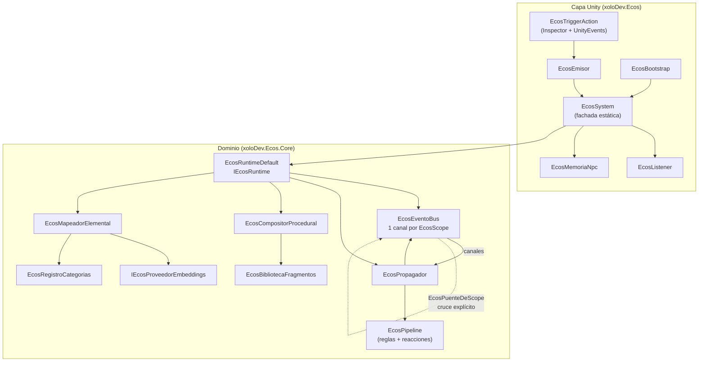
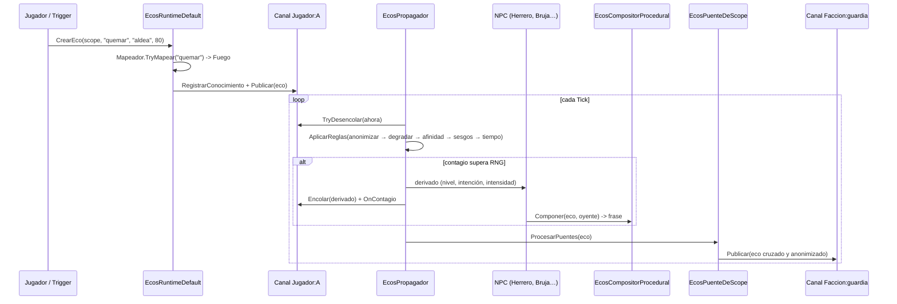

# Ecos — Arquitectura

> Sistema de propagación y degradación de rumores para NPCs, pensado para **Edge AI**:
> todo corre en local con cientos de NPCs, sin servidor, sin GPU y con determinismo total.

Namespace raíz: **`xoloDev.Ecos`** · Dominio puro: **`xoloDev.Ecos.Core`**

---

## 1. Principios de diseño

| Principio                     | Cómo se cumple                                                                                                                                                                                                             |
| ----------------------------- | -------------------------------------------------------------------------------------------------------------------------------------------------------------------------------------------------------------------------- |
| **Cero alucinaciones**        | Ningún modelo escribe texto. El eco es un hecho discreto (`SujetoId + AccionId + ObjetoId + Nivel + Intencion`) y la frase la arma un compositor procedural desde **diccionarios**. El modelo ligero sólo clasifica enums. |
| **Multijugador 1..N aislado** | Cada etiqueta (`EcosScope`) tiene su propio canal: cola de eventos, grafo de rumores y censo de NPCs. Dos jugadores nunca se ven sin un **puente explícito**.                                                              |
| **Determinismo total**        | Nada usa `UnityEngine.Random` ni `string.GetHashCode`. Todo sale de `EcosRng` (xorshift32) + `EcosHasher` (FNV-1a). Misma semilla = misma historia. `ModoSemilla` elige entre semilla fija (replay/continuar) y aleatoria por sesión; dentro de la sesión todo sigue siendo reproducible. |
| **Apto para Edge**            | Heurísticas de fábrica sin IA, techos duros (`MaxEventosPorTick`, `MaxSaltos`, `MaxContagiosPorEco`, `MaxNodosPorCanal`), structs `readonly` para evitar GC y reglas que se pueden desactivar.                                                   |
| **Rumor ≠ mensaje**           | El eco viaja como **hecho**, no como frase. Así el mismo hecho se cuenta distinto en cada boca sin inventar contenido.                                                                                                     |

---

## 2. Diagrama general



### Flujo de un eco



---

## 3. Ensamblados

| Ensamblado            | Ruta              | Depende de                            | Para qué                                                    |
| --------------------- | ----------------- | ------------------------------------- | ----------------------------------------------------------- |
| `xoloDev.Ecos.Core`   | `Scripts/Core`    | **nada** (`noEngineReferences: true`) | Dominio puro y testeable sin Unity (`dotnet build`).        |
| `xoloDev.Ecos`        | `Scripts/Runtime` | Core + UnityEngine                    | MonoBehaviour, ScriptableObjects y la fachada `EcosSystem`. |
| `xoloDev.Ecos.Editor` | `Scripts/Editor`  | Core + Runtime + UnityEditor          | Inspectores, botón _Emitir eco ahora_ y ventana de debug.   |

Separar el Core es lo que permite testear y simular el sistema headless (servidor, CI, pruebas
de balance) sin abrir el Editor.

---

## 4. Mapa de ficheros

### Core — Modelo (`Scripts/Core/Modelo`)

| Fichero                      | Responsabilidad                                                                                                          |
| ---------------------------- | ------------------------------------------------------------------------------------------------------------------------ |
| `EcoEvento.cs`               | **Struct readonly**. El hecho que viaja. Método `Derivar(...)` (copy-with) usado por todas las reglas.                   |
| `EcosScope.cs`               | Etiqueta de aislamiento (`Jugador`, `Faccion`, `Lugar`, `Grupo`, `Global`, `Sistema`). Clave de diccionario sin allocar. |
| `EcosPerfilNpc.cs`           | Personalidad de un NPC (locuacidad, credulidad, autoridad, memoria, sesgos) + su memoria de ecos.                        |
| `EcosContextoPropagacion.cs` | Foto inmutable de _quién cuenta qué a quién_; único parámetro de reglas y modelos.                                       |
| `EcosEnums.cs`               | `EcosNivelExageracion` (5), `EcosIntencion` (6), `EcosScopeKind`, `EcosTipoEnlace` + curvas `EcosNiveles`.               |
| `EcosVector.cs`              | Vector de embedding mínimo + coseno + centroide.                                                                         |

### Core — Contratos (`Scripts/Core/Contratos`)

`IEcosRuntime`, `IEcosEventoBus`, `IEcosModelos` (degradador, clasificador, embeddings, mapeador,
afinidad, compositor), `IEcosPropagacion` (reglas, reacciones, filtro). **Todo intercambiable.**

### Core — Infraestructura (`Scripts/Core/Infraestructura`)

| Fichero                 | Responsabilidad                                                                                                                    |
| ----------------------- | ---------------------------------------------------------------------------------------------------------------------------------- |
| `EcosEventoBus.cs`      | Un `EcosCanalDeEcos` por etiqueta. `Publicar` deposita en el canal del scope y entrega a los observadores; `Global` y `Grupo:"*"` son OBSERVADORES (sólo reciben el eco ORIGINAL). |
| `EcosCanalDeEcos.cs`    | Cola ordenada por `Entrega`, censo de NPCs, sinks y grafo. Unidad de aislamiento.                                                  |
| `EcosRuntimeDefault.cs` | Implementación de `IEcosRuntime`. Crea ecos, resuelve narradores y avanza el propagador.                                           |
| `EcosRuntimeBuilder.cs` | DI sin frameworks. Todo tiene su `Con...()`; rellena defaults y arma el pipeline.                                                  |

### Core — Grafo (`Scripts/Core/Grafo`)

| Fichero                | Responsabilidad                                                                                                                          |
| ---------------------- | ---------------------------------------------------------------------------------------------------------------------------------------- |
| `EcosGrafoDeEcos.cs`   | Memoria del canal: nodos = ecos, aristas = «X se enteró por W». Índices inversos por NPC (`ConocidosPor`) y por SUJETO (`EcosDe`).         |
| `EcosNodoEco.cs`       | Un eco + quién lo conoce + cuántas veces se difundió.                                                                                     |
| `EcosDossierSujeto.cs` | **Ficha derivada** del sujeto: reputación ponderada, ambivalencia moral y contradicciones. Se calcula del grafo; nunca duplica estado.     |

### Core — Propagación (`Scripts/Core/Propagacion`)

| Fichero                     | Responsabilidad                                                                                           |
| --------------------------- | --------------------------------------------------------------------------------------------------------- |
| `EcosPropagador.cs`         | Motor de difusión: drena colas, tantea NPCs, aplica reglas, re-encola y cruza puentes.                    |
| `EcosPuenteDeScope.cs`      | **Única** vía de salida de un canal. Reancla el eco (sujeto anonimizado, narración nueva).                |
| `EcosReglasEstandar.cs`     | 6 reglas: anonimización (50), degradación (100), contradicción (150), afinidad (200), sesgos (300), desvanecimiento (400). |
| `EcosModelosHeuristicos.cs` | Degradador, clasificador de intención y filtro de contagio de fábrica (los _enchufes_ del modelo ligero). |

El **ritmo** con el que un rumor salta de boca en boca (y por tanto se deforma) se ajusta en
`EcosConfiguracion`: `RetardoPropagacionBase` ± `RetardoPropagacionJitter` (escalado por nivel)
da un ritmo orgánico, mientras que `IntervaloDeformacion` (> 0) impone una **cadencia fija** —
«cada X segundos la información se deforma» — ignorando nivel, azar y sesgos a propósito, para
que el diseñador tenga un _timer_ predecible. Lo alimenta `EcosPropagador.CalcularRetardo`.

### Core — Semántica (`Scripts/Core/Semantica`)

`EcosRegistroCategorias` (fuego, agua, veneno, oscuridad, muerte, naturaleza, metal, tormenta +
ganancias de diseño), `EcosTablaAfinidad` (matriz data-driven elemento↔elemento),
`EcosRelacionesAcciones` (matriz data-driven **acción↔acción**: `Neutra` / `Sinergia` /
`Antagonista`, alimentada por `EcosAccion.AntagonistaDe`), `EcosMapeadorElemental`
(acción → categoría por **mejor sinónimo**, nearest-prototype), `EcosProveedorEmbeddingsHash`
(embeddings de respaldo léxico 96d) y `EcosPooling` (media enmascarada de la salida del transformer).

### Core — Texto (`Scripts/Core/Texto`)

`EcosBibliotecaFragmentos` (diccionarios de acciones/objetos + dataset español),
`EcosFragmentosDatos` (datos por defecto), `EcosCompositorProcedural` (`Normalizar` + marca
invisible para proteger la caja del sujeto; arma _Sujeto + Acción + Nivel + Intención_),
`EcosHechosDeDemo` (los cinco hechos de la escena de demo como datos: verbo + paciente +
cantidad, y `CrearBibliotecaDeDemo()` para los tests headless).

### Runtime — Unity (`Scripts/Runtime`)

| Fichero                         | Responsabilidad                                                                                                                                                  |
| ------------------------------- | ---------------------------------------------------------------------------------------------------------------------------------------------------------------- |
| `Facade/EcosSystem.cs`          | Fachada estática. `Inicializar(runtime)`, `RegistrarEvento(...)`, `Narrar(...)`. Auto-crea runtime con aviso si nadie inicializó.                                |
| `Facade/EcosScopeReferencia.cs` | `EcosRelojUnity`, `EcosJugadorLocal`, `EcosIdentidad`, `EcosScopeReferencia` (cómo resolver la etiqueta desde el GameObject).                                    |
| `Componentes/EcosBootstrap.cs`  | Monta el runtime desde assets; métodos `virtual` `CrearDegradador()/CrearClasificadorIntencion()/CrearProveedorEmbeddings()` (punto de entrada del modelo real). |
| `Componentes/EcosEmisor.cs`     | `EcosEmisor` (base) + `EcosTriggerAction` (Inspector, UnityEvents, trigger, Start, cooldown).                                                                    |
| `Componentes/EcosListener.cs`   | Sink que reacciona a ecos de un canal (`UnityEvent<EcoEvento>`).                                                                                                 |
| `Componentes/EcosMemoriaNpc.cs` | Memoria local del NPC + `EcosReaccionComponente`.                                                                                                                |
| `Configuracion/*Asset.cs`       | ScriptableObjects: `EcosConfigAsset`, `EcosBibliotecaAsset`, `EcosCategoriasAsset`, `EcosPerfilNpcAsset`.                                                        |

### Editor (`Scripts/Editor`)

`EcosInspectores.cs` (botón _Emitir eco ahora_, validaciones, menú de conjunto de assets) y
`EcosVentanaDebug.cs` (consola de canales + laboratorio de frases).

### Onnx — Proveedor de embeddings real (`Scripts/Onnx`)

`EcosProveedorEmbeddingsOnnx.cs`, bajo la constante `#if ECOS_ONNX` (apagada por defecto en
Unity): ejecuta un Sentence-Transformers exportado a ONNX sobre ONNX Runtime. Elige el
tokenizador por el fichero que recibe — `vocab.txt` → WordPiece/BERT; `sentencepiece.bpe.model`
→ SentencePiece/XLM-R — y devuelve `EcosVector`. La suite de pruebas (fuera de `Assets/`) lo
enlaza y define `ECOS_ONNX` para probarlo headless.

---

## 5. Reglas core y dónde viven

| Requisito                                | Implementación                                                                                                                                                                                   |
| ---------------------------------------- | ------------------------------------------------------------------------------------------------------------------------------------------------------------------------------------------------ |
| **1. Multijugador 1..N con aislamiento** | `EcosScope` + `EcosEventoBus` (1 canal por etiqueta) + `EcosCanalDeEcos`. El cruce sólo ocurre por `EcosPuenteDeScope` con `Anonimizar`. Los NPCs del canal A no resuelven estilo en el canal B. |
| **2. Cero alucinaciones**                | `IEcosDegradador` / `IEcosClasificadorIntencion` devuelven **enums**. `EcosCompositorProcedural` construye la frase desde `EcosBibliotecaFragmentos`. El eco nunca lleva texto libre.            |
| **3. Motor semántico universal**         | `IEcosMapeadorSemantico` + `EcosRegistroCategorias` + `EcosProveedorEmbeddingsOnnx` (multilingüe, FP16) o `EcosProveedorEmbeddingsHash` (respaldo léxico). Agnóstico al género: cruza vectores, no pistas de gameplay. Basta inyectar otro `IEcosProveedorEmbeddings`. La **intención** es procedural (ver 7.2). |
| **4. Disparadores duales**               | API: `EcosSystem.RegistrarEvento("JugadorA", "quemar", "aldea", 80)`. Inspector: `EcosTriggerAction` con `UnityEvent`s.                                                                          |
| **5. Acumulación y ambivalencia**        | Varios ecos del mismo sujeto son nodos independientes. `EcosReglaContradiccion` (150) penaliza al eco que choca con lo que el receptor ya cree (mismo paciente, acciones antagonistas) y lo refuerza si hay sinergia; `EcosDossierSujeto` agrega reputación, **ambivalencia moral** y contradicciones por canal. Nada se borra: ver `DESIGN_CONTRADICCIONES.md`. |

---

## 6. Cómo se usa

### 6.1 API para programadores

```csharp
using xoloDev.Ecos;
using xoloDev.Ecos.Core;

// 1. Arranque (una vez). Sin esto, EcosSystem crea un runtime por defecto con aviso.
EcosSystem.Inicializar(new EcosRuntimeBuilder()
    .ConReloj(new EcosRelojUnity())
    .ConPuente(EcosScope.Jugador("A"), EcosScope.Faccion("guardia"),
               anonimizar: true, saltosMinimos: 1, perdidaConfianza: 0.10f)
    .Construir());

// 2. Registrar NPCs.
EcosSystem.RegistrarNpc(new EcosPerfilNpc
{
    Id = "@Herrero", Nombre = "Herrero", Scope = EcosScope.Jugador("A"),
    Locuacidad = 0.90f, Credulidad = 0.80f, Autoridad = 0.55f, SesgoElementalClave = "fuego"
});

// 3. Provocar un hecho.
EcosSystem.RegistrarEvento("A", "quemar", "aldea", 80);

// 4. Avanzar la simulación (lo normal es que lo haga EcosBootstrap en Update).
EcosSystem.Tick(Time.deltaTime);

// 5. Leer el resultado: el eco más relevante que conoce un NPC.
if (EcosSystem.TryEcoMasRelevante(EcosScope.Jugador("A"), "@Herrero", out var eco))
    Debug.Log(EcosSystem.Narrar(eco, perfilDelHerrero));
// -> "Te lo advierto: Aldric prendió fuego a la aldea, ayer."
```

### 6.2 Inspector, sin escribir código

1. Añade un **`EcosBootstrap`** a la escena y asígnale los assets (`EcosConfigAsset`,
   `EcosBibliotecaAsset`, `EcosCategoriasAsset`).
2. Añade un **`EcosTriggerAction`** al objeto que provoca el hecho:
   - `scope`: jugador local, jugador concreto o facción.
   - `accionId` / `objetoId` / `intensidad` / `intencion`.
   - `emitirAlStart`, `emitirAlEntrarEnTrigger` (+ `tagDisparador`), `cooldown`, `soloUnaVez`.
   - `onEmision` (UnityEvent) y `onFrase` (UnityEvent<string>) para VFX/UI.
3. En el Editor aparece el botón **“Emitir eco ahora”** para probar en Play o en Edit.
4. **`EcosListener`** recibe los ecos de un canal y los publica en un `UnityEvent`.
5. **`EcosMemoriaNpc` + `EcosReaccionComponente`** dan memoria y reacciones data-driven.

---

## 7. Puntos de extensión (Edge AI)

El sistema está preparado para enchufar el modelo real sin tocar nada más. **Decisión final:**
sólo los **embeddings** (temas/elementos) usan modelo; la **intención** y la **degradación** se
quedan procedurales en el Core (ver 7.2).

```csharp
public class MiBootstrap : EcosBootstrap
{
    // Modelo multilingüe (español + inglés). El proveedor elige el tokenizador por el
    // fichero: sentencepiece.bpe.model -> XLM-R; vocab.txt -> WordPiece.
    // FP16 (~224 MB): formato validado. El paquete NO incluye pesos; este archivo lo
    // exporta el usuario y lo coloca en su proyecto.
    protected override IEcosProveedorEmbeddings CrearProveedorEmbeddings()
        => new EcosProveedorEmbeddingsOnnx(
               Path.Combine(Application.streamingAssetsPath, "Modelos/model.onnx"),
               Path.Combine(Application.streamingAssetsPath, "Modelos/sentencepiece.bpe.model.bytes"));

    // CrearDegradador() y CrearClasificadorIntencion() NO se sobrescriben: los de fábrica
    // (EcosDegradadorHeuristico / EcosClasificadorIntencionHeuristico) son los definitivos.
}
```

Contratos a implementar: `IEcosProveedorEmbeddings`, `IEcosDegradador`,
`IEcosClasificadorIntencion`, `IEcosFiltroContagio`, `IEcosMapeadorSemantico`. El resto del
sistema sólo conoce las interfaces.

### 7.1 Modelo de embeddings (multilingüe) — el "Motor Semántico Universal"

El **Mapeador Elemental** usa un Sentence-Transformers real exportado a ONNX. La misma
matemática (coseno + **mejor sinónimo**) resuelve TEMAS/ELEMENTOS de cualquier género sin una
sola línea de código específica: Terror (`"se ocultó en el casillero"` → *Ocultamiento*),
Shooter (`"eliminó al objetivo desde 500 metros"` → *Larga Distancia*), Plataformas
(`"se transformó en avión de papel"` → *Transformación*), RPG (`"rescató a los prisioneros"`
→ *Pacífico*). El Core es agnóstico al género: sólo cruza vectores.

| Aspecto            | Valor                                                                          |
| ------------------ | ------------------------------------------------------------------------------ |
| Modelo             | `sentence-transformers/paraphrase-multilingual-MiniLM-L12-v2` (XLM-R, 384 dims) |
| Formato recomendado| **FP16** (~224 MB) — validado con Inference Engine 2.6.1                        |
| Distribución       | **No incluido.** El comprador lo descarga y exporta; el paquete pesa ~1 MB.     |
| Formato descartado | **INT8** dinámico (~113 MB): Inference Engine 2.6.1 rechaza sus operadores       |
| Export FP16        | `exportar_fp16.py` (`optimum` + `onnxconverter-common`), documentado en el cap. 10 |
| Tokenizador        | `sentencepiece.bpe.model` (SentencePiece de XLM-R), renombrado a `.bytes`        |
| Idiomas            | Español e inglés **nativos** (necesario para vender el asset internacionalmente) |

**FP16 es el formato validado, pero no se distribuye.** Se exporta desde el fp32 de
HuggingFace y se baja a fp16 (`exportar_fp16.py`, con `optimum` + `onnxconverter-common`);
no sale de castear el INT8. El INT8 dinámico usa `DynamicQuantizeLinear` /
`MatMulInteger`, que Inference Engine 2.6.1 rechaza al importar (`OnnxImportException`),
así que no se recomienda. En GPU el fp16 es el formato natural; en CPU es más lento que un
INT8 compatible, pero funciona. La decisión se toma con los **márgenes de mapeo**
(`tests/Semantica`), que son la métrica que importa, no el tamaño.

El paquete de tienda se genera con `empaquetar.ps1 -SinModelo`; la carpeta
`Runtime/Modelos/` sólo contiene un `LEEME.txt`. El comprador sigue el capítulo
[10 — Modelo semántico](10-SemanticaONNX.md) para descargar el modelo, exportarlo y
asignarlo.

**Por qué multilingüe.** El antiguo `all-MiniLM-L6-v2` es **monolingüe inglés**: con español
daba cosenos ruidosos y `"el jugador incendió la cabaña"` caía en *Naturaleza* (la palabra
"cabaña" dominaba el _pool_ de la frase). Con el modelo multilingüe la misma frase cae en
**Fuego**.

**El remapeo de IDs (detalle crítico).** El grafo salió de HuggingFace, así que espera la
numeración de HuggingFace. El fichero SentencePiece numera distinto (`<unk>=0`, `<s>=1`,
`</s>=2`; el resto desplazado −1). `EcosProveedorEmbeddingsOnnx` traduce: `<unk>0→3`, `<s>1→0`,
`</s>2→2` y **el resto +1** (`pad`=1). Sin ese remapeo, las traducciones ES↔EN se desploman de
~0.88 a ~0.40, porque el modelo recibe tokens de otro idioma. Regla verificada pieza a pieza
contra `tokenizer.json`: 0 discrepancias en 250.000 piezas.

**Cruce por mejor sinónimo.** `EcosMapeadorElemental` no compara contra el centroide promedio
(que diluye sinónimos dispares) sino contra el **sinónimo más cercano** de cada categoría
(nearest-prototype), con el centroide como respaldo. Corolario de diseño: **la calidad del
sinónimo manda**. Términos de rol/HUD (`sniper`, `headshot`) no cubren una acción narrada
(`"eliminó al objetivo desde 500 metros"`); añadir sinónimos-frase sube el margen de +0.02
(ruido) a +0.41. Los diseñadores deben escribir sinónimos **del tipo de frase que el sistema
recibirá**, no etiquetas.

`modelo_ecos_multilingue/` contiene además `prueba_ia.py` (verifica el pipeline ONNX+SPM sin
Unity) y `laboratorio_intencion.py` (el experimento que descartó el zero-shot de intención; ver
7.2).

### 7.2 Por qué la INTENCIÓN no usa un modelo (decisión cerrada)

La intención comunicativa (`Advertencia`, `Alarde`, `Chisme`, `Amenaza`, `Lamento`, `Neutral`)
decide **plantilla y coletillas**, no el contenido del hecho. Se evaluaron dos vías y ambas se
descartaron:

1. **Reciclar el embedding como clasificador zero-shot por coseno**
   (`laboratorio_intencion.py`): **colapsa** — 3 de 4 frases caen en *Chisme*, con márgenes de
   **+0.014** sobre un fondo de cosenos ~0.39 (ruido). El coseno mide TEMAS, no fuerza
   ilocutiva.
2. **Cabeza lineal (linear probe) sobre el embedding congelado**: ajusta el dataset al 100% y
   un split aleatorio daba ~80%, pero **leave-one-action-out ≈ 14%** (azar 16.7%). Motivo: la
   etiqueta del heurístico es `f(AccionId)` (un decreto de diseño), y eso **no es
   generalizable desde el texto**. Con supervisión por REGISTRO (estilo del texto, tomado de
   `EcosAtribucionIntencion`), el mismo embedding y la misma cabeza suben a ~88%: el techo lo
   pone la **supervisión**, no el modelo.

**Conclusión.** La intención se queda procedural (`EcosClasificadorIntencionHeuristico`) y no se
embarca una segunda cabeza: sería un ~9 KB que sólo añade error a una tabla ya exacta. La
semántica real (temas/elementos) es donde el modelo gana, y ahí sí se usa.

---

## 8. Validación

Prueba funcional end-to-end (fuera del proyecto Unity, ejecutando sólo `Core`):

- Propagación de un rumor de fuego con **5 saltos** y frases distintas por NPC.
- **Aislamiento**: el canal del Jugador B queda en `nodos=0` (sin contaminación).
- **Puente**: un rumor viajado cruza `Jugador:A → Faccion:guardia` **anonimizado**
  (“alguien prendió fuego a la aldea”) y el Capitán lo aprende y lo narra.
- **Mapeo elemental**: `quemar → Fuego`, `envenenar el pozo → Veneno`, `robar → Oscuridad`,
  `inundar → Agua`, `invocar una tempestad → Tormenta`; `salvar` / `vender pan → sin categoría`.
- **Modelo real multilingüe**: con `EcosProveedorEmbeddingsOnnx` (FP16) + el registro por
  defecto, `"el jugador incendió la cabaña" → Fuego` y `"el jugador envenenó el pozo" → Veneno`
  (tests end-to-end en `tests/Semantica`).
- **Motor semántico universal**: 4 géneros extremos con categorías disjuntas (*Ocultamiento*,
  *Larga Distancia*, *Transformación*, *Pacífico*) resuelven sus **acciones crudas** con margen
  sólido sobre la 2ª categoría (≥ 0.15 exigido; medido 0.26–0.56) y sin contaminación cruzada
  (`tests/Semantica/MotorSemanticoUniversalTests.cs`). Es la garantía de que el Core sirve para
  Terror, Shooter, Plataformas y RPG sin ramas específicas.
- **5 niveles** de exageración con magnitud numérica creciente.
- **Determinismo**: misma semilla → misma frase byte a byte.

---

## 9. Notas de diseño

- **El eco es un hecho, no una frase.** Viajar como `(Sujeto, Acción, Objeto, Nivel, Intención)`
  es lo que permite que cada NPC lo cuente distinto sin que ningún modelo genere texto.
- **Un canal = un grafo.** El aislamiento no es una comprobación en runtime: es la topología.
- **La contradicción modula, no borra.** `EcosReglaContradiccion` baja la credibilidad de un
  relato que choca con lo que el oyente ya cree, pero los dos ecos siguen vivos en el grafo.
  Que la gente se crea versiones incompatibles del mismo sujeto **es** el juego (y es lo que
  mide `EcosDossierSujeto.Ambivalencia`). El único mecanismo de olvido es la purga por tiempo.
- **La moral no vive en la intención.** `EcosIntencion` es comunicativa («cómo lo cuento»);
  el juicio de valor vive en `EcosAccion.Valencia`/`Peso`. Mezclarlos rompería las plantillas
  de frase.
- **El techo de saltos es el número de bocas.** `EcosPropagador` descarta a todo receptor que ya
  conozca el eco (`EcosGrafoDeEcos.Conoce`, indexado por `eco.Id`, que `Derivar` **conserva**), así
  que cada NPC se contagia como mucho una vez por rumor: con N NPCs en el canal un eco da **como
  máximo N saltos**. `maxSaltos` sólo pone el límite superior, no una meta. Además el eco muere si
  baja de `umbralConfianzaMinima`, por lo que las cadenas largas también piden bajar
  `factorCredibilidadPorSalto` (el término `(1 − credibilidad(nivel)) × 0.25` de
  `EcosReglaDegradacion` es fijo y no se puede ajustar por asset).
- **El abanico aplana la cadena; no la alarga.** Subir `probabilidadContagioBase` para «llegar más
  lejos» produce el efecto contrario: con 6 bocas y un 0,9, casi todo el canal se entera en el
  **primer** salto, el eco se satura y no queda nadie nuevo que lo descubra, así que la
  profundidad cae a 1-2 saltos. La profundidad efectiva la fija el **reparto**, no el azar.
  `maxContagiosPorEco = 1` obliga a que cada salto lo coja **una sola boca nueva**: el rumor
  camina de NPC en NPC y la cadena recorre el censo entero (N saltos). Con ese tope, subir
  `probabilidadContagioBase` vuelve a ser seguro (sólo evita que un salto se pierda por azar);
  sin él, es justo lo que aplana la cadena. `0` deja el abanico clásico. Cubierto por
  `tests/Propagacion/ProfundidadTests.cs` (mismo escenario y misma probabilidad —0,9—, sólo
  cambia el tope: abanico → ≤2 saltos; una boca → 6).
- **Una boca por salto no es una cadena garantizada.** Con `maxContagiosPorEco = 1` sólo hay
  **una tirada por salto**, y la probabilidad del filtro estándar decae con la credibilidad y el
  nivel (`base × locuacidad × credulidad × autoridad × confianza × (1 − 0,12·nivel)`). Un fallo a
  mitad mata el rumor: el mismo asset puede dar 3 saltos en una partida y 5 en otra, y en el juego
  se lee como un tope del sistema. Para demos y campañas guionizadas existe
  `ContagioGarantizado` (**off por defecto**): devuelve probabilidad 1 y la profundidad queda
  determinada sólo por `maxSaltos` y el censo del canal. Cubierto por
  `tests/Propagacion/DemoMirrorTests.cs`.
- **Todos los sinks ven todos los saltos.** Cada entrega se notifica a *todos* los suscriptores
  del canal, así que si cada NPC pinta su etiqueta con el último eco recibido, las N etiquetas
  acaban mostrando el mismo texto y parece que no hubo deformación. Para un escaparate,
  `EcosListener.soloCuandoSoyElNarrador` deja que cada NPC conserve la versión que él mismo
  contaría (`eco.NarradorId == nombre del GameObject`), y `EcosPuenteTexto` antepone
  `v3 · [categoría] · Adornado · 78 %` (boca, categoría, nivel y credibilidad restante). El eco
  original (saltos 0) lo ven todos. La **última** versión (`saltos == maxSaltos`) también se
  entrega a los sinks —aunque ya no se propague— para que la boca final muestre su texto: de ahí
  el `<=` en `mereceRepetirse`.
- **La deformación tiene que verse en la frase, no sólo en el enum.** Subir `Nivel` no basta si
  los huecos de la plantilla salen vacíos. Dos arreglos: (1) `ElegirMagnitud` cae a otra banda
  cuando la del nivel está vacía (la biblioteca de la demo no tiene `MagnitudAlta` en los niveles
  bajos y los hechos de intensidad alta se quedaban sin magnitud); (2) la plantilla se elige
  **antes** del color, porque es la plantilla quien decide si hay hueco `{color}` — antes una
  tirada fallida dejaba «..., y con por todas partes». `ColoresDeReserva` evita el hueco cojo.
  Efecto visible con `factorDegradacionPorSalto = 0,22` (preset de la demo): los seis saltos
  recorren Literal → Suavizado → Adornado → Exagerado → Distorsionado, el nombre se anonimiza
  («Aldric» → «alguien») y la confianza cae de 1,00 a ~0,14. Cubierto por
  `tests/Composicion/EscaladaTests.cs` y `DemoMirrorTests`.
- **El eco es el mismo hecho: lo que cambia es cómo se cuenta.** Por diseño (*Cero
  Alucinaciones*) ni el compositor ni el degradador inventan un verbo o un paciente nuevos: un
  «se ocultó en el casillero» nunca se convierte en «mató a alguien». La deformación es nivel,
  intención, magnitud, adornos, anonimización y credibilidad.
- **La CANTIDAD es el único dato que se exagera, y es un dato declarado.** «Magnificar la
  magnitud» era hasta ahora un multiplicador invisible (`Intensidad`). `EcosAccion.CantidadBase`,
  `UnidadCantidad` y `PreposicionCantidad` convierten la magnitud en una cifra que viaja en la
  frase. `EcosEscaladorCantidades` calcula la curva automática a partir del nivel, la intensidad,
  la intención y el oyente: «desde 500 metros» (Literal) → 750 → 1.000 → 1.400 → «desde 2.000
  metros» (Distorsionado). Sigue siendo *Cero Alucinaciones*: el diseñador declara la cifra real
  y el sistema sólo la transforma; verbo y paciente no cambian. `{magnitud}` prefiere la cifra al
  adjetivo de banda y, si la plantilla del nivel no tiene el hueco, el compositor **lo inyecta
  tras el objeto**: la cantidad es dato, no adorno, así que no puede desaparecer a mitad de
  cadena. Cubierto por `tests/Composicion/CantidadTests.cs`.
- **Un recuento escala con colectivo e instrumento, no sólo con la cifra.** `CantidadBase` es el
  único número obligatorio; `ContenedoresPorNivel` e `InstrumentosPorNivel` (5 textos) son
  opcionales y convierten «un grupo de 10 bandidos, con su espada» en «un pelotón de ~1.100
  bandidos, con las manos desnudas». La cifra sale de la curva automática de recuentos (10 → 30 →
  90 → 350 → ~1.100), no de una tabla escrita a mano. `CantidadesPorNivel` sigue existiendo como
  override exacto para casos especiales. Con `CantidadComoObjeto` la cantidad **sustituye al
  paciente** («eliminó a un pelotón de ~1.100 bandidos»), de modo que el dato es el objeto
  gramatical; si es `false`, la cifra viaja como cláusula («..., desde 500 metros»). El
  instrumento se cuelga del objeto para que ninguna plantilla lo pierda. Todo sale del
  diccionario de la acción: el rumor exagera el dato, nunca inventa el verbo.
- **Los hechos de la demo viven en el Core, no en la escena.** `EcosHechosDeDemo` declara los
  cinco hechos (verbo conjugado + paciente con artículo + cantidad + categoría de género) y
  `EcosHechosDeDemo.CrearBibliotecaDeDemo()` los monta sobre la biblioteca por defecto. El
  builder los refresca en el asset en cada reconstrucción
  (`EcosBibliotecaAsset.AgregarHechosDeDemo`) sin tocar el resto del vocabulario, así que los
  tests headless reproducen la cadena de la escena
  (`DemoMirrorTests.La_cantidad_del_hecho_se_exagera_a_lo_largo_de_la_cadena`). Las acciones de
  la demo declaran además su categoría de género, de modo que el mapeador elemental acierta por
  **atajo** (coste cero) en vez de depender de los embeddings.
- **Contracciones del español en la normalización.** El compositor une un verbo que acaba en
  preposición («eliminó a») con un objeto que empieza por artículo («el objetivo»), y sin la
  regla salía «eliminó a el objetivo». `Normalizar` aplica `a el → al` y `de el → del` al final,
  con independencia de cómo se hayan combinado los fragmentos.
- **`Global` es un observador, no un canal.** Sus suscriptores reciben el eco **original** en el
  instante de publicarse y nunca las versiones degradadas; además, un canal `Global` **no tiene
  sinks** (todos sus suscriptores van a la lista de observadores). Por eso un componente que deba
  reaccionar a la degradación (`EcosListener`, `EcosMemoriaNpc`) tiene que suscribirse a un canal
  real (`Jugador:*`, `Faccion:*`...), no a `Global`.
- **El puente reancla la narración.** Al cruzar, el eco pierde al narrador de origen
  (`NarradorDestino = ""` → “voz anónima”) para que el estilo de un NPC de un canal no se
  filtre al otro. Si el diseñador quiere que entre por boca de alguien, lo indica.
- **El trinquete de degradación** (`EcosDegradadorHeuristico`) garantiza que un rumor nunca
  “mejora” al viajar; sólo se suaviza, se adorna o se distorsiona.
