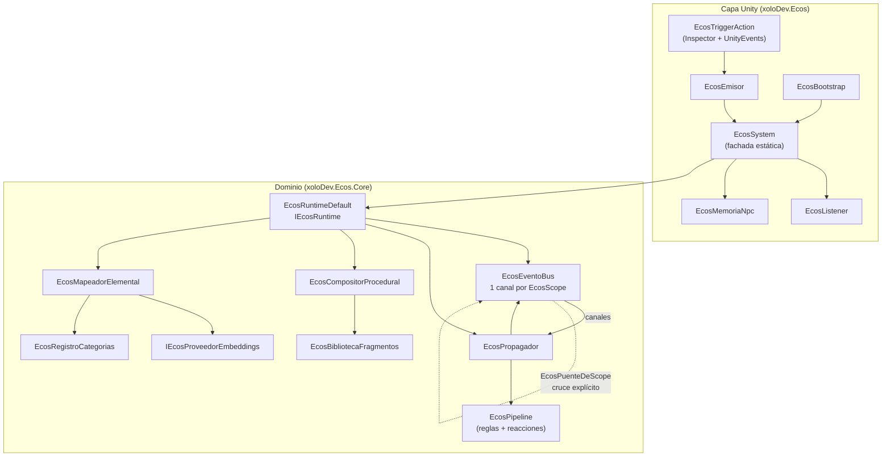
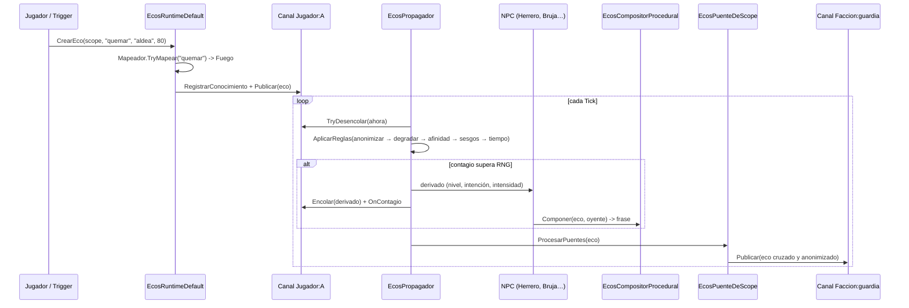

# Ecos — Architecture

> Rumor propagation and degradation system for NPCs, designed for **Edge AI**:
> everything runs locally with hundreds of NPCs, no server, no GPU, and full determinism.

Root namespace: **`xoloDev.Ecos`** · Pure domain: **`xoloDev.Ecos.Core`**

---

## 1. Design principles

| Principle                     | How it is met                                                                                                                                                                                                             |
| ----------------------------- | -------------------------------------------------------------------------------------------------------------------------------------------------------------------------------------------------------------------------- |
| **Zero Hallucinations**       | No model writes text. The echo is a discrete fact (`SujetoId + AccionId + ObjetoId + Nivel + Intencion`) and the sentence is assembled by a procedural composer from **dictionaries**. The lightweight model only classifies enums. |
| **Isolated 1..N multiplayer** | Each tag (`EcosScope`) has its own channel: event queue, rumor graph, and NPC census. Two players never see each other without an **explicit bridge**.                                                              |
| **Total determinism**         | Nothing uses `UnityEngine.Random` or `string.GetHashCode`. Everything comes from `EcosRng` (xorshift32) + `EcosHasher` (FNV-1a). Same seed = same story. `ModoSemilla` chooses between a fixed seed (replay/continue) and a random one per session; within the session everything remains reproducible. |
| **Edge-ready**                | Factory heuristics without AI, hard ceilings (`MaxEventosPorTick`, `MaxSaltos`, `MaxContagiosPorEco`, `MaxNodosPorCanal`), `readonly` structs to avoid GC, and rules that can be disabled.                                                   |
| **Rumor ≠ message**           | The echo travels as a **fact**, not as a sentence. That way the same fact is told differently in each mouth without inventing content.                                                                                                     |

---

## 2. Overview diagram



### The flow of an echo



---

## 3. Assemblies

| Assembly              | Path              | Depends on                            | Purpose                                                     |
| --------------------- | ----------------- | ------------------------------------- | ----------------------------------------------------------- |
| `xoloDev.Ecos.Core`   | `Scripts/Core`    | **nothing** (`noEngineReferences: true`) | Pure domain, testable without Unity (`dotnet build`).       |
| `xoloDev.Ecos`        | `Scripts/Runtime` | Core + UnityEngine                    | MonoBehaviour, ScriptableObjects, and the `EcosSystem` facade. |
| `xoloDev.Ecos.Editor` | `Scripts/Editor`  | Core + Runtime + UnityEditor          | Inspectors, the _Emitir eco ahora_ button, and the debug window.   |

Splitting out the Core is what makes it possible to test and simulate the system headless
(server, CI, balance tests) without opening the Editor.

---

## 4. File map

### Core — Model (`Scripts/Core/Modelo`)

| File                         | Responsibility                                                                                                           |
| ---------------------------- | ------------------------------------------------------------------------------------------------------------------------ |
| `EcoEvento.cs`               | **Readonly struct**. The fact that travels. `Derivar(...)` (copy-with) method used by all rules.                   |
| `EcosScope.cs`               | Isolation tag (`Jugador`, `Faccion`, `Lugar`, `Grupo`, `Global`, `Sistema`). Dictionary key without allocating. |
| `EcosPerfilNpc.cs`           | Personality of an NPC (talkativeness, credulity, authority, memory, biases) + their echo memory.                        |
| `EcosContextoPropagacion.cs` | Immutable snapshot of _who tells what to whom_; the single parameter for rules and models.                                       |
| `EcosEnums.cs`               | `EcosNivelExageracion` (5), `EcosIntencion` (6), `EcosScopeKind`, `EcosTipoEnlace` + `EcosNiveles` curves.               |
| `EcosVector.cs`              | Minimal embedding vector + cosine + centroid.                                                                         |

### Core — Contracts (`Scripts/Core/Contratos`)

`IEcosRuntime`, `IEcosEventoBus`, `IEcosModelos` (degrader, classifier, embeddings, mapper,
affinity, composer), `IEcosPropagacion` (rules, reactions, filter). **Everything swappable.**

### Core — Infrastructure (`Scripts/Core/Infraestructura`)

| File                    | Responsibility                                                                                                                     |
| ----------------------- | ---------------------------------------------------------------------------------------------------------------------------------- |
| `EcosEventoBus.cs`      | One `EcosCanalDeEcos` per tag. `Publicar` deposits into the scope's channel and delivers to observers; `Global` and `Grupo:"*"` are OBSERVERS (they only receive the ORIGINAL echo). |
| `EcosCanalDeEcos.cs`    | Queue ordered by `Entrega`, NPC census, sinks, and graph. The unit of isolation.                                                  |
| `EcosRuntimeDefault.cs` | Implementation of `IEcosRuntime`. Creates echoes, resolves narrators, and advances the propagator.                                           |
| `EcosRuntimeBuilder.cs` | DI without frameworks. Everything has its `Con...()`; it fills in defaults and assembles the pipeline.                                                  |

### Core — Graph (`Scripts/Core/Grafo`)

| File                   | Responsibility                                                                                                                           |
| ---------------------- | ---------------------------------------------------------------------------------------------------------------------------------------- |
| `EcosGrafoDeEcos.cs`   | Channel memory: nodes = echoes, edges = “X learned it from W”. Reverse indexes by NPC (`ConocidosPor`) and by SUBJECT (`EcosDe`).         |
| `EcosNodoEco.cs`       | An echo + who knows it + how many times it spread.                                                                                     |
| `EcosDossierSujeto.cs` | **Derived sheet** for the subject: weighted reputation, moral ambivalence, and contradictions. Computed from the graph; never duplicates state.     |

### Core — Propagation (`Scripts/Core/Propagacion`)

| File                        | Responsibility                                                                                            |
| --------------------------- | --------------------------------------------------------------------------------------------------------- |
| `EcosPropagador.cs`         | Diffusion engine: drains queues, samples NPCs, applies rules, re-enqueues, and crosses bridges.                    |
| `EcosPuenteDeScope.cs`      | The **only** way out of a channel. Re-anchors the echo (anonymized subject, new narration).                |
| `EcosReglasEstandar.cs`     | 6 rules: anonymization (50), degradation (100), contradiction (150), affinity (200), biases (300), fading (400). |
| `EcosModelosHeuristicos.cs` | Factory degrader, intention classifier, and contagion filter (the _plugs_ for the lightweight model). |

The **rhythm** at which a rumor jumps from mouth to mouth (and therefore deforms) is set in
`EcosConfiguracion`: `RetardoPropagacionBase` ± `RetardoPropagacionJitter` (scaled by level)
gives an organic rhythm, while `IntervaloDeformacion` (> 0) imposes a **fixed cadence** —
“every X seconds the information deforms” — deliberately ignoring level, chance, and biases, so
that the designer has a predictable _timer_. It is fed by `EcosPropagador.CalcularRetardo`.

### Core — Semantics (`Scripts/Core/Semantica`)

`EcosRegistroCategorias` (fire, water, poison, darkness, death, nature, metal, storm +
design gains), `EcosTablaAfinidad` (data-driven element↔element matrix),
`EcosRelacionesAcciones` (data-driven **action↔action** matrix: `Neutra` / `Sinergia` /
`Antagonista`, fed by `EcosAccion.AntagonistaDe`), `EcosMapeadorElemental`
(action → category by **best synonym**, nearest-prototype), `EcosProveedorEmbeddingsHash`
(96d lexical fallback embeddings), and `EcosPooling` (masked mean of the transformer output).

### Core — Text (`Scripts/Core/Texto`)

`EcosBibliotecaFragmentos` (action/object dictionaries + Spanish dataset),
`EcosFragmentosDatos` (default data), `EcosCompositorProcedural` (`Normalizar` + an
invisible mark to protect the subject's slot; assembles _Subject + Action + Level + Intention_),
`EcosHechosDeDemo` (the five facts of the demo scene as data: verb + patient +
quantity, and `CrearBibliotecaDeDemo()` for the headless tests).

### Runtime — Unity (`Scripts/Runtime`)

| File                            | Responsibility                                                                                                                                                  |
| ------------------------------- | ---------------------------------------------------------------------------------------------------------------------------------------------------------------- |
| `Facade/EcosSystem.cs`          | Static facade. `Inicializar(runtime)`, `RegistrarEvento(...)`, `Narrar(...)`. Auto-creates a runtime with a warning if nobody initialized it.                                |
| `Facade/EcosScopeReferencia.cs` | `EcosRelojUnity`, `EcosJugadorLocal`, `EcosIdentidad`, `EcosScopeReferencia` (how to resolve the tag from the GameObject).                                    |
| `Componentes/EcosBootstrap.cs`  | Builds the runtime from assets; `virtual` methods `CrearDegradador()/CrearClasificadorIntencion()/CrearProveedorEmbeddings()` (entry point for the real model). |
| `Componentes/EcosEmisor.cs`     | `EcosEmisor` (base) + `EcosTriggerAction` (Inspector, UnityEvents, trigger, Start, cooldown).                                                                    |
| `Componentes/EcosListener.cs`   | Sink that reacts to echoes from a channel (`UnityEvent<EcoEvento>`).                                                                       |
| `Componentes/EcosMemoriaNpc.cs` | Local NPC memory + `EcosReaccionComponente`.                                                                                                                |
| `Configuracion/*Asset.cs`       | ScriptableObjects: `EcosConfigAsset`, `EcosBibliotecaAsset`, `EcosCategoriasAsset`, `EcosPerfilNpcAsset`.                                                        |

### Editor (`Scripts/Editor`)

`EcosInspectores.cs` (the _Emitir eco ahora_ button, validations, asset collection menu) and
`EcosVentanaDebug.cs` (channel console + sentence lab).

### Onnx — Real embeddings provider (`Scripts/Onnx`)

`EcosProveedorEmbeddingsOnnx.cs`, under the `#if ECOS_ONNX` constant (off by default in
Unity): it runs a Sentence-Transformers exported to ONNX on ONNX Runtime. It picks the
tokenizer based on the file it receives — `vocab.txt` → WordPiece/BERT; `sentencepiece.bpe.model`
→ SentencePiece/XLM-R — and returns an `EcosVector`. The test suite (outside `Assets/`) links it
and defines `ECOS_ONNX` to test it headless.

---

## 5. Core rules and where they live

| Requirement                                | Implementation                                                                                                                                                                                   |
| ---------------------------------------- | ------------------------------------------------------------------------------------------------------------------------------------------------------------------------------------------------ |
| **1. 1..N multiplayer with isolation** | `EcosScope` + `EcosEventoBus` (1 channel per tag) + `EcosCanalDeEcos`. Crossing only happens through `EcosPuenteDeScope` with `Anonimizar`. NPCs in channel A do not resolve style in channel B. |
| **2. Zero Hallucinations**                | `IEcosDegradador` / `IEcosClasificadorIntencion` return **enums**. `EcosCompositorProcedural` builds the sentence from `EcosBibliotecaFragmentos`. The echo never carries free text.            |
| **3. Universal semantic engine**         | `IEcosMapeadorSemantico` + `EcosRegistroCategorias` + `EcosProveedorEmbeddingsOnnx` (multilingual, FP16) or `EcosProveedorEmbeddingsHash` (lexical fallback). Genre-agnostic: it crosses vectors, not gameplay hints. Injecting another `IEcosProveedorEmbeddings` is enough. **Intention** is procedural (see 7.2). |
| **4. Dual triggers**                     | API: `EcosSystem.RegistrarEvento("JugadorA", "quemar", "aldea", 80)`. Inspector: `EcosTriggerAction` with `UnityEvent`s.                                                                          |
| **5. Accumulation and ambivalence**      | Several echoes from the same subject are independent nodes. `EcosReglaContradiccion` (150) penalizes the echo that clashes with what the receiver already believes (same patient, antagonistic actions) and reinforces it when there is synergy; `EcosDossierSujeto` aggregates reputation, **moral ambivalence**, and contradictions per channel. Nothing is erased: see `DESIGN_CONTRADICCIONES.md`. |

---

## 6. How to use it

### 6.1 API for programmers

```csharp
using xoloDev.Ecos;
using xoloDev.Ecos.Core;

// 1. Bootstrap (once). Without this, EcosSystem creates a default runtime and warns.
EcosSystem.Inicializar(new EcosRuntimeBuilder()
    .ConReloj(new EcosRelojUnity())
    .ConPuente(EcosScope.Jugador("A"), EcosScope.Faccion("guardia"),
               anonimizar: true, saltosMinimos: 1, perdidaConfianza: 0.10f)
    .Construir());

// 2. Register NPCs.
EcosSystem.RegistrarNpc(new EcosPerfilNpc
{
    Id = "@Herrero", Nombre = "Herrero", Scope = EcosScope.Jugador("A"),
    Locuacidad = 0.90f, Credulidad = 0.80f, Autoridad = 0.55f, SesgoElementalClave = "fuego"
});

// 3. Trigger a fact.
EcosSystem.RegistrarEvento("A", "quemar", "aldea", 80);

// 4. Advance the simulation (normally EcosBootstrap does this in Update).
EcosSystem.Tick(Time.deltaTime);

// 5. Read the result: the most relevant echo an NPC knows.
if (EcosSystem.TryEcoMasRelevante(EcosScope.Jugador("A"), "@Herrero", out var eco))
    Debug.Log(EcosSystem.Narrar(eco, perfilDelHerrero));
// -> "I warn you: Aldric set fire to the village, yesterday."
```

### 6.2 Inspector, without writing code

1. Add an **`EcosBootstrap`** to the scene and assign it the assets (`EcosConfigAsset`,
   `EcosBibliotecaAsset`, `EcosCategoriasAsset`).
2. Add an **`EcosTriggerAction`** to the object that triggers the fact:
   - `scope`: local player, specific player, or faction.
   - `accionId` / `objetoId` / `intensidad` / `intencion`.
   - `emitirAlStart`, `emitirAlEntrarEnTrigger` (+ `tagDisparador`), `cooldown`, `soloUnaVez`.
   - `onEmision` (UnityEvent) and `onFrase` (UnityEvent<string>) for VFX/UI.
3. In the Editor, the **“Emitir eco ahora”** button appears so you can test in Play or Edit mode.
4. **`EcosListener`** receives the echoes of a channel and publishes them to a `UnityEvent`.
5. **`EcosMemoriaNpc` + `EcosReaccionComponente`** provide memory and data-driven reactions.

---

## 7. Extension points (Edge AI)

The system is ready to plug in the real model without touching anything else. **Final decision:**
only **embeddings** (topics/elements) use a model; **intention** and **degradation** remain
procedural in the Core (see 7.2).

```csharp
public class MiBootstrap : EcosBootstrap
{
    // Multilingual model (Spanish + English). The provider picks the tokenizer from the
    // file name: sentencepiece.bpe.model -> XLM-R; vocab.txt -> WordPiece.
    // FP16 (~224 MB): validated format. The package does NOT include weights; the user
    // exports this file and places it in their project.
    protected override IEcosProveedorEmbeddings CrearProveedorEmbeddings()
        => new EcosProveedorEmbeddingsOnnx(
               Path.Combine(Application.streamingAssetsPath, "Modelos/model.onnx"),
               Path.Combine(Application.streamingAssetsPath, "Modelos/sentencepiece.bpe.model.bytes"));

    // CrearDegradador() and CrearClasificadorIntencion() are NOT overridden: the built-in
    // ones (EcosDegradadorHeuristico / EcosClasificadorIntencionHeuristico) are final.
}
```

Contracts to implement: `IEcosProveedorEmbeddings`, `IEcosDegradador`,
`IEcosClasificadorIntencion`, `IEcosFiltroContagio`, `IEcosMapeadorSemantico`. The rest of the
system only knows the interfaces.

### 7.1 Embeddings model (multilingual) — the "Universal Semantic Engine"

The **Elemental Mapper** uses a real Sentence-Transformers exported to ONNX. The same
math (cosine + **best synonym**) resolves TOPICS/ELEMENTS of any genre without a
single line of genre-specific code: Horror (`"se ocultó en el casillero"` → *Ocultamiento*),
Shooter (`"eliminó al objetivo desde 500 metros"` → *Larga Distancia*), Platforms
(`"se transformó en avión de papel"` → *Transformación*), RPG (`"rescató a los prisioneros"`
→ *Pacífico*). The Core is genre-agnostic: it only crosses vectors.

| Aspect             | Value                                                                          |
| ------------------ | ------------------------------------------------------------------------------ |
| Model              | `sentence-transformers/paraphrase-multilingual-MiniLM-L12-v2` (XLM-R, 384 dims) |
| Recommended format | **FP16** (~224 MB) — validated with Inference Engine 2.6.1                        |
| Distribution       | **Not included.** Buyers download and export it; the package weighs ~1 MB.     |
| Discarded format   | **Dynamic INT8** (~113 MB): Inference Engine 2.6.1 rejects its operators       |
| FP16 export        | `exportar_fp16.py` (`optimum` + `onnxconverter-common`), documented in ch. 10 |
| Tokenizer          | `sentencepiece.bpe.model` (XLM-R's SentencePiece), renamed to `.bytes`        |
| Languages          | Spanish and English **natively** (needed to sell the asset internationally) |

**FP16 is the validated format, but it is not distributed.** It is exported from HuggingFace's
fp32 and downcast to fp16 (`exportar_fp16.py`, with `optimum` + `onnxconverter-common`);
it does not come from casting the INT8. Dynamic INT8 uses `DynamicQuantizeLinear` /
`MatMulInteger`, which Inference Engine 2.6.1 rejects on import (`OnnxImportException`),
so it is not recommended. On GPU, fp16 is the natural format; on CPU it is slower than a
compatible INT8, but it works. The decision is made with the **mapping margins**
(`tests/Semantica`), which are the metric that matters, not the size.

The store package is generated with `empaquetar.ps1 -SinModelo`; the
`Runtime/Modelos/` folder only contains a `LEEME.txt`. The buyer follows chapter
[10 — Semantic model](10-SemanticaONNX.md) to download the model, export it, and
assign it.

**Why multilingual.** The old `all-MiniLM-L6-v2` is **English-monolingual**: with Spanish
it produced noisy cosines and `"el jugador incendió la cabaña"` fell into *Naturaleza* (the word
"cabaña" dominated the sentence _pool_). With the multilingual model, the same sentence falls into
**Fuego**.

**ID remapping (critical detail).** The graph came from HuggingFace, so it expects
HuggingFace's numbering. The SentencePiece file numbers differently (`<unk>=0`, `<s>=1`,
`</s>=2`; the rest shifted by −1). `EcosProveedorEmbeddingsOnnx` translates: `<unk>0→3`, `<s>1→0`,
`</s>2→2`, and **the rest +1** (`pad`=1). Without that remapping, ES↔EN translations collapse from
~0.88 to ~0.40, because the model receives tokens from another language. A rule verified piece by piece
against `tokenizer.json`: 0 discrepancies across 250,000 pieces.

**Matching by best synonym.** `EcosMapeadorElemental` compares not against the average centroid
(which dilutes disparate synonyms) but against the **closest synonym** of each category
(nearest-prototype), with the centroid as a fallback. Design corollary: **synonym quality is what
matters**. Role/HUD terms (`sniper`, `headshot`) do not cover a narrated action
(`"eliminó al objetivo desde 500 metros"`); adding sentence-synonyms raises the margin from +0.02
(noise) to +0.41. Designers should write synonyms **of the kind of sentence the system will
receive**, not labels.

`modelo_ecos_multilingue/` also contains `prueba_ia.py` (verifies the ONNX+SPM pipeline without
Unity) and `laboratorio_intencion.py` (the experiment that ruled out zero-shot intention; see
7.2).

### 7.2 Why INTENTION does not use a model (closed decision)

The communicative intention (`Advertencia`, `Alarde`, `Chisme`, `Amenaza`, `Lamento`, `Neutral`)
decides **template and stock phrases**, not the content of the fact. Two approaches were evaluated
and both were discarded:

1. **Reusing the embedding as a cosine zero-shot classifier**
   (`laboratorio_intencion.py`): **it collapses** — 3 out of 4 sentences fall into *Chisme*, with margins of
   **+0.014** over a cosine background of ~0.39 (noise). Cosine measures TOPICS, not illocutionary
   force.
2. **Linear head (linear probe) over the frozen embedding**: it fits the dataset at 100% and
   a random split gave ~80%, but **leave-one-action-out ≈ 14%** (chance 16.7%). Reason: the
   heuristic's label is `f(AccionId)` (a design decree), and that **is not
   generalizable from text**. With supervision by RECORD (text style, taken from
   `EcosAtribucionIntencion`), the same embedding and the same head rise to ~88%: the ceiling is
   set by the **supervision**, not the model.

**Conclusion.** Intention stays procedural (`EcosClasificadorIntencionHeuristico`) and a second
head is not shipped: it would be ~9 KB that only adds error to an already exact table. Real
semantics (topics/elements) is where the model wins, and that is where it is used.

---

## 8. Validation

End-to-end functional test (outside the Unity project, running only `Core`):

- Propagation of a fire rumor with **5 hops** and different sentences per NPC.
- **Isolation**: Player B's channel is left at `nodos=0` (no contamination).
- **Bridge**: a traveled rumor crosses `Jugador:A → Faccion:guardia` **anonymized**
  (“alguien prendió fuego a la aldea”) and the Captain learns it and narrates it.
- **Elemental mapping**: `quemar → Fuego`, `envenenar el pozo → Veneno`, `robar → Oscuridad`,
  `inundar → Agua`, `invocar una tempestad → Tormenta`; `salvar` / `vender pan → sin categoría`.
- **Real multilingual model**: with `EcosProveedorEmbeddingsOnnx` (FP16) + the default registry,
  `"el jugador incendió la cabaña" → Fuego` and `"el jugador envenenó el pozo" → Veneno`
  (end-to-end tests in `tests/Semantica`).
- **Universal semantic engine**: 4 extreme genres with disjoint categories (*Ocultamiento*,
  *Larga Distancia*, *Transformación*, *Pacífico*) resolve their **raw actions** with a solid
  margin over the 2nd category (≥ 0.15 required; measured 0.26–0.56) and without cross-contamination
  (`tests/Semantica/MotorSemanticoUniversalTests.cs`). It is the guarantee that the Core works for
  Horror, Shooter, Platforms, and RPG without specific branches.
- **5 levels** of exaggeration with increasing numeric magnitude.
- **Determinism**: same seed → same sentence, byte for byte.

---

## 9. Design notes

- **The echo is a fact, not a sentence.** Traveling as `(Sujeto, Acción, Objeto, Nivel, Intención)`
  is what lets each NPC tell it differently without any model generating text.
- **One channel = one graph.** Isolation is not a runtime check: it is the topology.
- **Contradiction modulates, it does not erase.** `EcosReglaContradiccion` lowers the credibility of an
  account that clashes with what the listener already believes, but both echoes stay alive in the graph.
  That people believe incompatible versions of the same subject **is** the game (and it is what
  `EcosDossierSujeto.Ambivalencia` measures). The only forgetting mechanism is time-based purging.
- **Morality does not live in intention.** `EcosIntencion` is communicative (“how I tell it”);
  the value judgment lives in `EcosAccion.Valencia`/`Peso`. Mixing them would break the sentence
  templates.
- **The hop ceiling is the number of mouths.** `EcosPropagador` discards any receiver who already
  knows the echo (`EcosGrafoDeEcos.Conoce`, indexed by `eco.Id`, which `Derivar` **preserves**), so
  each NPC is infected at most once per rumor: with N NPCs in the channel an echo gives **at most
  N hops**. `maxSaltos` only sets the upper bound, not a goal. Moreover, the echo dies if it drops
  below `umbralConfianzaMinima`, so long chains also require lowering
  `factorCredibilidadPorSalto` (the `(1 − credibilidad(nivel)) × 0.25` term in
  `EcosReglaDegradacion` is fixed and cannot be adjusted per asset).
- **The fan-out flattens the chain; it does not lengthen it.** Raising `probabilidadContagioBase`
  to “reach farther” produces the opposite effect: with 6 mouths and 0.9, almost the whole channel
  learns at the **first** hop, the echo saturates and no one new is left to discover it, so depth
  drops to 1-2 hops. Effective depth is set by the **distribution**, not by chance.
  `maxContagiosPorEco = 1` forces each hop to be picked up by **a single new mouth**: the rumor
  walks from NPC to NPC and the chain traverses the entire census (N hops). With that cap, raising
  `probabilidadContagioBase` becomes safe again (it only prevents a hop from being lost to chance);
  without it, that is precisely what flattens the chain. `0` leaves the classic fan-out. Covered by
  `tests/Propagacion/ProfundidadTests.cs` (same scenario and same probability —0,9—, only the cap
  changes: fan-out → ≤2 hops; one mouth → 6).
- **One mouth per hop is not a guaranteed chain.** With `maxContagiosPorEco = 1` there is only
  **one roll per hop**, and the standard filter's probability decays with credulity and
  level (`base × locuacidad × credulidad × autoridad × confianza × (1 − 0,12·nivel)`). A failure
  halfway kills the rumor: the same asset can give 3 hops in one run and 5 in another, and in the game
  it reads as a system cap. For demos and scripted campaigns there is
  `ContagioGarantizado` (**off by default**): it returns probability 1 and depth is left
  determined only by `maxSaltos` and the channel's census. Covered by
  `tests/Propagacion/DemoMirrorTests.cs`.
- **All sinks see all hops.** Each delivery is notified to *all* subscribers
  of the channel, so if each NPC paints its label with the last echo received, the N labels
  end up showing the same text and it looks as if there was no deformation. For a showcase,
  `EcosListener.soloCuandoSoyElNarrador` lets each NPC keep the version he himself
  would tell (`eco.NarradorId == nombre del GameObject`), and `EcosPuenteTexto` prefixes
  `v3 · [categoría] · Adornado · 78 %` (mouth, category, level, and remaining credibility). The
  original echo (hops 0) is seen by everyone. The **last** version (`saltos == maxSaltos`) is also
  delivered to the sinks —even though it no longer propagates— so that the final mouth shows its text: hence
  the `<=` in `mereceRepetirse`.
- **Deformation has to show in the sentence, not only in the enum.** Raising `Nivel` is not enough if
  the template's slots come out empty. Two fixes: (1) `ElegirMagnitud` falls back to another band
  when the level's band is empty (the demo library has no `MagnitudAlta` at low levels and
  high-intensity facts were left without a magnitude); (2) the template is chosen
  **before** the color, because it is the template that decides whether there is a `{color}` slot — before,
  a failed roll left "..., y con por todas partes". `ColoresDeReserva` avoids the broken slot.
  Visible effect with `factorDegradacionPorSalto = 0,22` (the demo preset): the six hops
  run through Literal → Smoothed → Adorned → Exaggerated → Distorted, the name is anonymized
  (“Aldric” → “alguien”) and confidence drops from 1,00 to ~0,14. Covered by
  `tests/Composicion/EscaladaTests.cs` and `DemoMirrorTests`.
- **The echo is the same fact: what changes is how it is told.** By design (*Zero
  Hallucinations*) neither the composer nor the degrader invents a new verb or patient: a
  “se ocultó en el casillero” never becomes “mató a alguien”. Deformation is level,
  intention, magnitude, adornments, anonymization, and credibility.
- **QUANTITY is the only datum that gets exaggerated, and it is a declared datum.** “Magnifying the
  magnitude” was until now an invisible multiplier (`Intensidad`). `EcosAccion.CantidadBase`,
  `UnidadCantidad`, and `PreposicionCantidad` turn the magnitude into a figure that travels in the
  sentence. `EcosEscaladorCantidades` computes the automatic curve from level, intensity,
  intention, and listener: “desde 500 metros” (Literal) → 750 → 1.000 → 1.400 → “desde 2.000
  metros” (Distorted). It is still *Zero Hallucinations*: the designer declares the real figure
  and the system only transforms it; verb and patient do not change. `{magnitud}` prefers the figure
  over the band adjective and, if the level's template does not have the slot, the composer **injects
  it after the object**: quantity is data, not adornment, so it cannot disappear halfway through the
  chain. Covered by `tests/Composicion/CantidadTests.cs`.
- **A head count scales with collective and instrument, not just with the figure.** `CantidadBase` is the
  only mandatory number; `ContenedoresPorNivel` and `InstrumentosPorNivel` (5 texts) are
  optional and turn “un grupo de 10 bandidos, con su espada” into “un pelotón de ~1.100
  bandidos, con las manos desnudas”. The figure comes from the automatic head-count curve (10 → 30 →
  90 → 350 → ~1.100), not from a hand-written table. `CantidadesPorNivel` still exists as an
  exact override for special cases. With `CantidadComoObjeto` the quantity **replaces the
  patient** (“eliminó a un pelotón de ~1.100 bandidos”), so that the datum is the grammatical
  object; if it is `false`, the figure travels as a clause (“..., desde 500 metros”). The
  instrument hangs off the object so that no template loses it. Everything comes from the
  action's dictionary: the rumor exaggerates the datum, it never invents the verb.
- **The demo facts live in the Core, not in the scene.** `EcosHechosDeDemo` declares the
  five facts (conjugated verb + patient with article + quantity + genre category) and
  `EcosHechosDeDemo.CrearBibliotecaDeDemo()` mounts them on the default library. The
  builder refreshes them in the asset on every rebuild
  (`EcosBibliotecaAsset.AgregarHechosDeDemo`) without touching the rest of the vocabulary, so the
  headless tests reproduce the scene's chain
  (`DemoMirrorTests.La_cantidad_del_hecho_se_exagera_a_lo_largo_de_la_cadena`). The demo actions
  also declare their genre category, so that the elemental mapper gets it right by
  **shortcut** (zero cost) instead of depending on the embeddings.
- **Spanish contractions in normalization.** The composer joins a verb that ends in
  a preposition (“eliminó a”) with an object that starts with an article (“el objetivo”), and without the
  rule it produced “eliminó a el objetivo”. `Normalizar` applies `a el → al` and `de el → del` at the end,
  regardless of how the fragments were combined.
- **`Global` is an observer, not a channel.** Its subscribers receive the **original** echo at
  the moment it is published and never the degraded versions; moreover, a `Global` channel **has no
  sinks** (all of its subscribers go to the observer list). That is why a component that must
  react to degradation (`EcosListener`, `EcosMemoriaNpc`) has to subscribe to a real channel
  (`Jugador:*`, `Faccion:*`...), not to `Global`.
- **The bridge re-anchors the narration.** On crossing, the echo loses its source narrator
  (`NarradorDestino = ""` → “anonymous voice”) so that the style of an NPC from one channel does not
  leak into the other. If the designer wants it to come through someone's mouth, they say so.
- **The degradation ratchet** (`EcosDegradadorHeuristico`) guarantees that a rumor never
  “improves” as it travels; it is only smoothed, adorned, or distorted.
